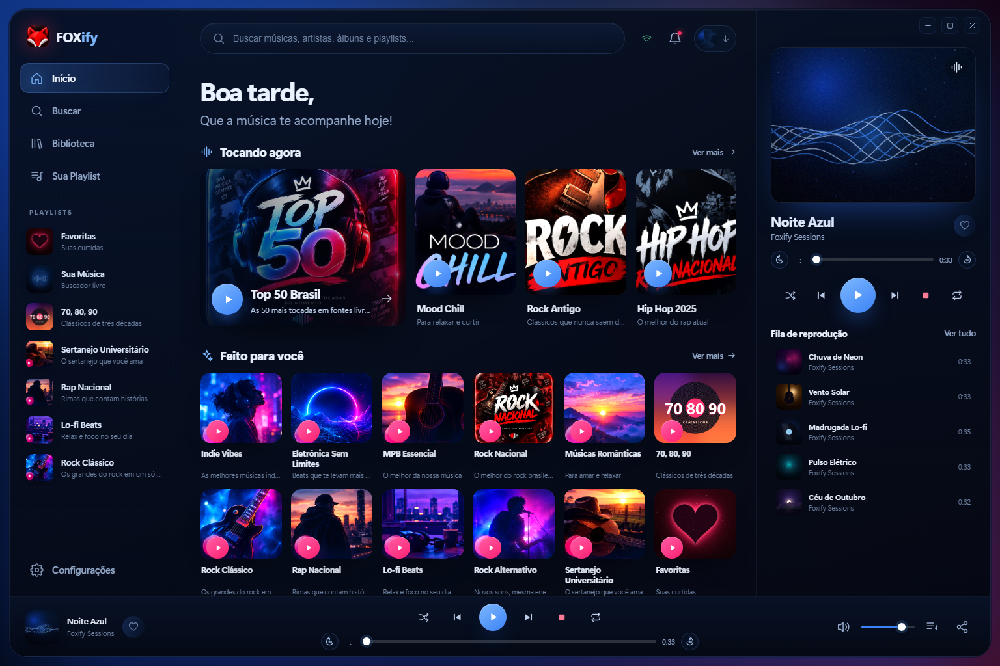
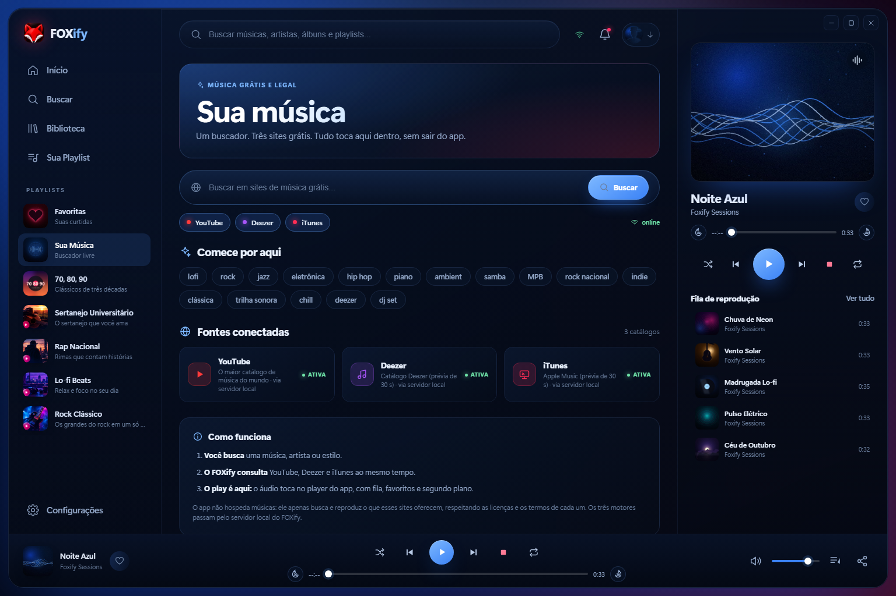
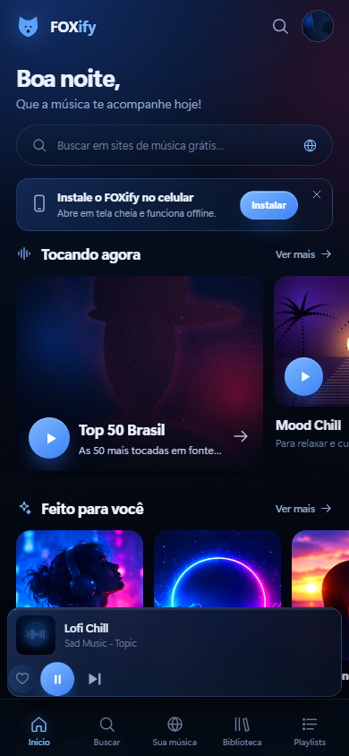
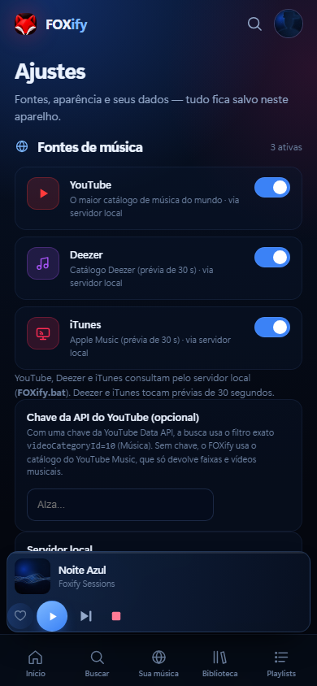

# FOXify 🦊 — sua música livre

Player de streaming inspirado no mockup, agora com **três motores de busca: YouTube,
Deezer e iTunes**. O buscador **Sua Música** consulta os três, mostra os resultados e
**toca tudo dentro do próprio app** — com fila, favoritos, playlists, segundo plano e modo offline.

Funciona como **PWA instalável no Android** (tela cheia, ícone próprio, offline) e no
computador, com o layout completo de três colunas.



[](https://render.com/deploy?repo=https://github.com/AdrianoFox83/FOXify-Music)

**Repositório pronto:** https://github.com/AdrianoFox83/FOXify-Music — o botão acima
cria o servidor na nuvem; depois é só gerar o APK com a URL do Render.

---

## Novidades da versão 1.6.4

- **Render/nuvem:** quando o IP do servidor é bloqueado pelo YouTube, o app usa o
  **player incorporado do YouTube** no aparelho para tocar o áudio completo (sem mostrar
  vídeo). No PC/local, continua baixando o áudio pelo `yt-dlp`.
- Deezer/iTunes na nuvem buscam o vídeo correspondente no YouTube e tocam pelo player
  incorporado; se não houver resultado, usam a prévia de 30 s.

## Novidades da versão 1.6.3

- **Suporte a APK:** novo campo **Ajustes → Servidor do FOXify (APK)**. Informe o endereço
  do PC que roda o `FOXify.bat` (`http://192.168.x.x:8765`).
- O servidor ganhou CORS/PNA para o APK conseguir chamar a API em outra origem.
- As mensagens de erro agora explicam que o APK precisa apontar para o servidor.

## Novidades da versão 1.6.2

- **Categorias corrigidas:** cada estação do início agora usa uma lista de artistas-semente
  da própria categoria (MPB, Rock Nacional, Sertanejo, Rap Nacional, Lo-fi etc.) em vez
  de uma busca genérica. O app consulta o Deezer para esses artistas e toca as músicas
  completas pelo YouTube.
- Top 50 Brasil, Mood Chill, Rock Antigo e as demais estações não misturam mais gêneros.

## Novidades da versão 1.6.1

- **Deezer e iTunes agora tocam a música completa**, não só 30 s: o catálogo vem da
  API e o áudio completo é buscado no YouTube pelo título + artista.
- Se o YouTube não encontrar a faixa, o app usa a **prévia de 30 s** como último recurso.

## Novidades da versão 1.6.0

- **Bandcamp e HearThis.at saíram do motor.** Entraram **Deezer** e **iTunes Search**
  (Apple Music).
- As APIs são consultadas pelo proxy local; o player toca as **prévias de 30 segundos**
  que Deezer e iTunes liberam sem conta.
- A busca do iTunes usa `media=music`, `entity=song`, `country=BR`; o Deezer usa
  `/search` e ordena por rank.

## Novidades da versão 1.5.2

- Corrigido o **cache das capas**: Top 50, Mood Chill, Rock Antigo e Hip Hop 2025 agora
  usam arquivos com nomes novos (`-novo.jpg`) e o service worker passou a buscar
  imagens/código **primeiro na rede**. As capas antigas não voltam mais.

## Novidades da versão 1.5.1

- **Funk 2025 saiu** do início; no mesmo lugar entrou **Rock Nacional**.
- Novas capas: Top 50 Brasil, Mood Chill, Rock Antigo, Hip Hop 2025/Rap Nacional e
  Rock Nacional, usando as imagens enviadas.

## Novidades da versão 1.5.0

- **Motor enxuto:** só **YouTube, Bandcamp e HearThis.at**. Jamendo, Internet Archive
  e Audius saíram da busca e da tela de fontes.
- **Bandcamp e HearThis voltaram a tocar:** o áudio agora passa pelo proxy local com o
  `Referer` correto de cada CDN, em vez de ser bloqueado pelo hotlink.
- O player **destrava o áudio dentro do toque** (faixa silenciosa curta) antes de resolver
  a URL; isso evita o play suspenso no Android/WebView.
- Busca do Bandcamp com nova tentativa automática quando o leitor Jina limita a consulta.
- As versões abaixo são histórico; algumas fontes citadas nelas não fazem mais parte do motor.

## Novidades da versão 1.4.2

- **Novo logo** vermelho no cabeçalho e nos ícones do aplicativo (Android/PWA).
- Botões **−30 s** e **+30 s** ao lado da barra de progresso, no player e na tela cheia.
  As setas `←`/`→` do teclado também pulam 30 segundos.

## Novidades da versão 1.4.1

- Novo botão **Parar** (quadrado vermelho) na barra do player, no mini player e na
  tela cheia. Ele para a música, limpa a faixa/fila, fecha a aba do player e esconde
  a barra — sem ficar aquela janela aberta.
- O ZIP agora é gerado **sem a pasta `FOXify` dentro**, para não criar
  `FOXify\FOXify` ao extrair.

## Novidades da versão 1.4

- **YouTube toca só o áudio, sem vídeo.** O servidor baixa a faixa com o
  `yt-dlp` incluído no projeto e o player normal do FOXify toca (capa, título,
  progresso e fila), sem painel de vídeo e sem iframe.
- O primeiro play de uma música baixa o áudio (alguns segundos); depois ela fica
  no cache local `_cache_yt` e toca na hora.
- Nada de instalar `yt-dlp` à mão: ele vai junto em `_vendor/yt_dlp`.

## Novidades da versão 1.3

- **Busca de música mais limpa**, com regra específica por motor:
  YouTube só música + “official”; Internet Archive só `mediatype=audio`;
  Jamendo e Bandcamp priorizam popularidade; HearThis só faixas curtas.
- **YouTube Music** como catálogo musical (sem chave) e campo opcional para a
  YouTube Data API com `videoCategoryId=10`.
- Jamendo com **fallback pelo Jina Reader + stream por ID**, funcionando mesmo
  quando a API do site responde `403`.

## Novidades da versão 1.2

- **Capas da referência enviada** nas playlists do início (Indie Vibes, Eletrônica,
  MPB, Rock Nacional, Rock Clássico, Rap Nacional, Lo-fi, Rock Alternativo e Sertanejo).
- **Sons do Amanhecer saiu**; no lugar entrou **Músicas Românticas**.
- Novo card **70, 80, 90** (também na barra lateral).
- Grade de 12 cards em duas linhas, com os botões de play grandes no estilo da imagem.

## Novidades da versão 1.1

- **Jamendo Music** direto do site, **sem chave de API** (o catálogo independente).
- **YouTube** no buscador: os resultados tocam no FOXify (hoje só o áudio, sem vídeo).
- **Bandcamp** e **HearThis.at** adicionados.
- **Seis fontes** no total: Audius, Internet Archive, Jamendo Music, YouTube, Bandcamp
  e HearThis.at.
- Player com **motor duplo**: áudio comum (MP3/WAV) e YouTube (hoje em modo áudio).
- Ajustes mostram quais fontes usam o servidor local e um botão para testá-lo.



---

## Comece por aqui

### 1. No computador

Dê um duplo clique em **`FOXify.bat`**. Ele sobe o servidor local e abre o app numa
janela do Edge/Chrome sem barra de navegador (modo aplicativo).

É preciso ter **Python 3** instalado ([python.org/downloads](https://www.python.org/downloads/)).
O motor de busca usa o servidor local; sem ele, YouTube, Deezer e iTunes não
conseguem buscar/tocar.

### 2. No celular Android (mesma rede Wi-Fi)

1. Duplo clique em **`FOXify-celular.bat`**.
2. A janela preta mostra o endereço **“No celular (Wi-Fi)”**, por exemplo
   `http://192.168.0.15:8765/`.
3. Abra esse endereço no **Chrome do Android**.
4. Se o Windows perguntar, libere o Python no firewall (redes privadas).

> O servidor precisa ficar aberto enquanto o celular usa o app. Mantenha o PC ligado.

### 3. Rodar em qualquer rede (nuvem) e gerar o APK

Para o FOXify funcionar em **qualquer internet, sem depender do seu PC**, o backend
precisa ficar hospedado online. O projeto já inclui `Dockerfile`, `render.yaml`,
`Procfile` e `fly.toml`; o passo a passo está em
[`deploy/README.md`](deploy/README.md).

1. Envie esta pasta para um repositório GitHub.
2. No Render/Railway/Fly, crie um serviço **Docker** a partir do repositório.
3. Abra a URL pública e confirme `https://SEU-APP/api/health`.
4. Instale o PWA ou gere o APK no PWABuilder usando essa URL.

O APK gerado a partir da URL publicada carrega o app e a API na **mesma origem**:
não precisa do seu PC nem de configurar servidor. O plano free pode hibernar; para uso
diário, uma VPS pequena é mais estável.

**Se o APK empacota os arquivos localmente (WebView):** ele continua sem backend.
Nesse caso, em **Ajustes → Servidor do FOXify (APK)**, informe a URL **HTTPS** do deploy
e toque em **Testar servidor**. O Android bloqueia uma página HTTPS chamando HTTP.

**Se o Render bloquear o YouTube:** adicione seus cookies como **Secret File**
`cookies.txt` no Render (o servidor lê `/etc/secrets/cookies.txt`) e faça Manual Deploy.
`/api/health` mostrará `"cookies": true`. O passo a passo está em
[`deploy/README.md`](deploy/README.md). **Nunca** comite cookies no GitHub.

> **Importante:** YouTube, Deezer e iTunes passam pelo servidor para busca e áudio. Um
> site estático (Netlify/GitHub Pages) **não** tem esse servidor; publique o `servidor.py`
> em Docker como acima. O PC local (`FOXify.bat`) continua útil para testes, mas não é
> necessário depois do deploy.

---

## O que o app faz

### Início
- Saudação por horário, busca rápida e estações em destaque.
- **Tocando agora**: Top 50 Brasil, Mood Chill, Rock Antigo e Hip Hop 2025.
- **Feito para você**: 12 cards em duas linhas, com as capas da referência enviada —
  Indie Vibes, Eletrônica Sem Limites, MPB Essencial, **Rock Nacional**, **Músicas Românticas**,
  **70, 80, 90**, Rock Clássico, Rap Nacional, Lo-fi Beats, Rock Alternativo,
  Sertanejo Universitário e Favoritas.
- **Estações por categoria**: cada card usa uma lista de artistas-semente do gênero
  (ex.: Rock Nacional → Legião Urbana, Titãs, Cazuza; MPB → Caetano, Chico, Gal)
  e toca as faixas completas pelo YouTube.
- **Sua Música**: atalhos para os três motores.
- Continuar ouvindo, favoritas e playlists.

### Sua Música (substitui “Descobertas da Semana”)
- Busca simultânea em **YouTube, Deezer e iTunes**.
- Resultados agrupados por fonte, com capa, artista, duração e selo de origem.
- Filtros por fonte, sugestões, buscas recentes, status online/offline.
- **Tocar tudo** e play por faixa — o áudio abre no player do app.
- Avisos por fonte quando um site bloqueia/limita a consulta.

### Player
- Fila, aleatório, repetir fila/faixa, avançar/voltar, seek e volume.
- Favoritas, histórico e playlists próprias (criar, renomear, excluir, adicionar faixas).
- Tela cheia no celular e painel lateral no desktop.
- **Media Session**: play/pause/next na tela de bloqueio e nos fones.
- Reprodução em segundo plano no Chrome Android.
- **YouTube só áudio**: sem vídeo, sem iframe e sem painel flutuante. O servidor baixa
  a faixa e o player normal do FOXify toca; o primeiro play pode levar alguns segundos.
- **Botão Parar** na barra/mini/tela cheia: encerra a música, limpa a fila e fecha o
  painel do player.
- Se uma fonte externa não responde, o app pula a faixa e, após duas falhas, cai
  automaticamente para as faixas demo locais.



### Biblioteca, Sua Playlist e Ajustes
- Favoritas, playlists, histórico e fontes conectadas.
- Tema de acento (azul, rosa, verde, âmbar), volume, limpeza de dados e instalação.
- Ajustes listam os três motores, indicam que usam o servidor local e permitem testá-lo.



### Offline
- O service worker guarda a interface, as capas e as 6 faixas **Foxify Sessions**
  (≈ 9 MB) para tocar sem internet.
- Buscas e streaming das fontes externas precisam de conexão.

---

## Fontes de música

| Fonte | O que é | Como toca | Servidor local? |
|---|---|---|---|
| **YouTube** | O maior catálogo de música do mundo | Áudio baixado pelo servidor, sem vídeo | Sim (busca e áudio) |
| **Deezer** | Catálogo do Deezer | Áudio completo via YouTube; prévia de 30 s só como fallback | Sim |
| **iTunes** | Catálogo Apple Music | Áudio completo via YouTube; prévia de 30 s só como fallback | Sim |

As playlists do início ainda usam catálogos internos (Audius/Archive) para as capas e
faixas das estações, mas **esses sites não aparecem no buscador**.

O FOXify **não hospeda músicas**: ele apenas busca e reproduz o que esses sites oferecem,
respeitando as licenças e os termos de cada um. As faixas “Foxify Sessions” são
sintetizadas localmente para demonstração e uso offline.

### Limitações conhecidas
- **Deezer e iTunes** não liberam o stream completo pela API pública. O FOXify usa a API
  só para o catálogo e busca o áudio completo no YouTube; se não achar, toca a prévia de 30 s.
- O **iTunes Search** limita requisições por IP; o app tenta duas vezes e guarda a
  busca por 10 minutos. Se voltar `429`, aguarde um pouco.
- **YouTube** pode recusar o download de algum vídeo (idade, região, bloqueio); o app
  pula para o próximo. O primeiro play baixa o áudio e pode demorar alguns segundos;
  depois fica em `_cache_yt`.
- **YouTube/Deezer/iTunes** precisam do servidor local.

---

## Como a busca filtra cada motor

| Motor | Regra aplicada |
|---|---|
| **YouTube** | Sempre busca `termo + " official"`; usa o catálogo **YouTube Music** (só faixas/videoclipes) e descarta mixes longos (30 s–15 min). Com uma chave opcional da YouTube Data API em **Ajustes**, usa `videoCategoryId=10` (Música) de forma estrita. |
| **Deezer** | Consulta `api.deezer.com/search`, mantém só faixas com `preview`, ordena por `rank`; para tocar, busca `título + artista + official` no YouTube e usa o áudio completo (prévia de 30 s como fallback). |
| **iTunes** | Consulta `itunes.apple.com/search` com `media=music`, `entity=song` e `country=BR`; para tocar, busca `título + artista + official` no YouTube e usa o áudio completo (prévia de 30 s como fallback). |

> **Chave do YouTube (opcional):** em **Ajustes → Fontes** há um campo para a chave
> da YouTube Data API. Sem ela, o app usa o YouTube Music, que já é um catálogo
> exclusivamente musical. A chave fica só no `localStorage` deste aparelho.

---

## Controles

**No celular:** toque para tocar; toque na mini player para abrir a tela cheia; arraste o
cabeçalho/arte para baixo para fechar.

**No computador:**

| Tecla | Ação |
|---|---|
| `Espaço` | play / pause |
| `←` / `→` | voltar / avançar 30 s |
| `↑` / `↓` | volume |
| `M` | mudo |
| `L` | curtir a faixa atual |
| `Q` | abrir a fila |
| `Esc` | fechar modais / player |

---

## Estrutura do projeto

```
FOXify/
├─ index.html                 # interface (desktop + mobile) e ícones SVG
├─ manifest.webmanifest       # instalação do PWA
├─ sw.js                      # cache offline (inclui Range para áudio)
├─ servidor.py                # servidor local + proxy + áudio do YouTube (yt-dlp)
├─ _vendor/yt_dlp/            # yt-dlp incluído (baixa só o áudio do YouTube)
├─ _cache_yt/                 # áudios do YouTube já baixados (criado em tempo de execução)
├─ FOXify.bat                 # abre no PC em janela de app
├─ FOXify-celular.bat         # mostra o endereço para o Android
├─ assets/
│  ├─ css/estilos-1.6.0.css
│  ├─ js/dados-1.6.4.js       # estações, playlists, fontes e faixas demo
│  ├─ js/fontes-1.6.4.js      # YouTube, Deezer, iTunes + curadoria das estações
│  ├─ js/player-1.6.4.js      # áudio + YouTube (só som), fila, Media Session, watchdog
│  ├─ js/app-1.6.4.js         # rotas, telas, biblioteca, busca e ajustes
│  ├─ img/capas/              # 23 capas (10 da referência + geradas)
│  ├─ img/icones/             # ícones do PWA
│  └─ audio/                  # 6 faixas demo WAV
├─ ferramentas/
│  ├─ gerar_artes.py          # gera as capas com Pillow
│  ├─ gerar_audio.py          # sintetiza as faixas com numpy
│  ├─ verificar.py            # checagem de ícones/arquivos/ações
│  └─ capturar.mjs            # testes de tela via DevTools Protocol
└─ docs/capturas/             # prints usados neste README
```

### Detalhes técnicos
- Sem framework e sem build: HTML/CSS/JS puro, ícones SVG inline.
- Dados do usuário em `localStorage` (`foxify.v1`).
- O servidor local serve os arquivos com suporte a `Range` e faz proxy das APIs que
  bloqueiam CORS, com cabeçalhos específicos de Deezer e iTunes.
- O proxy só aceita `https`, bloqueia endereços privados e não armazena nada.
- O áudio das fontes externas é reproduzido no elemento `<audio>` do app; no YouTube o
  servidor baixa **somente o áudio** com `yt-dlp` e entrega ao mesmo player, sem vídeo.

---

## Solução de problemas

**“Faixa pulando” / “Não foi possível tocar”**
O CDN da fonte pode estar indisponível ou bloqueado na sua rede. O app tenta as próximas
e, após duas falhas, toca a demonstração local. Teste outra busca/rede.

**“Deezer agora” / “iTunes agora”**
Limite de consultas da API ou CDN instável. Aguarde um minuto e tente de novo; o iTunes
já tenta duas vezes e o app guarda a busca por 10 minutos.

**A busca não retorna nada**
Veja se as fontes estão ativas em **Ajustes → Fontes** e se o servidor local está
respondendo (botão **Testar servidor**). Em redes corporativas, use `FOXify.bat` em vez
de abrir o `index.html` direto.

**O áudio não começa depois da busca**
Alguns navegadores exigem um novo toque na faixa (política de autoplay). Toque mais uma
vez no play. No YouTube, o primeiro play baixa o áudio e pode demorar alguns segundos;
os próximos saem do cache.

**O celular não abre o endereço**
Mesmo Wi-Fi? Firewall do Windows liberado? Teste o endereço no PC primeiro.

**O app instalado continua com versão antiga**
Feche e reabra; o service worker baixa a nova versão. Para forçar:
Chrome → Configurações → Armazenamento → Limpar dados do site.

**Quero apagar meus dados**
Ajustes → Seus dados → Limpar tudo.

---

## Testes realizados

- Layout desktop 1536×1024 e Android 390×844 (DevTools Protocol).
- **12 cards do início** com as capas da referência, incluindo Músicas Românticas e 70, 80, 90.
- Busca nos três motores; grupos e contagens conferidos.
- **Categorias curadas**: Rock Nacional 30 faixas (Legião, Titãs, Cazuza…), MPB 29,
  Sertanejo 29, Top 50 30, Rock Antigo 30, Mood Chill 30, Rap Nacional 30 e Lo-fi 30.
- **Deezer e iTunes tocando a música completa via YouTube**; prévia de 30 s só como
  fallback.
- **Filtros por motor**: YouTube Music com `official`, Deezer por rank e iTunes por
  relevância (`country=BR`).
- Reprodução de Deezer/iTunes (áudio completo) e **YouTube só áudio via yt-dlp**
  (MP4/WebM no player normal).
- Watchdog de áudio, retry e fallback automático para as faixas demo.
- Favoritar, criar playlist e persistência em `localStorage`.
- Service worker ativo, navegação offline e áudio demo offline.

---

Feito com foco no seu pedido: a cara do mockup, **Sua Música** no lugar de
“Descobertas da Semana”, busca nos sites grátis — agora com **YouTube, Deezer e
iTunes** — e play dentro do app.
